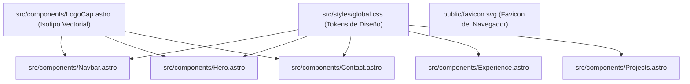
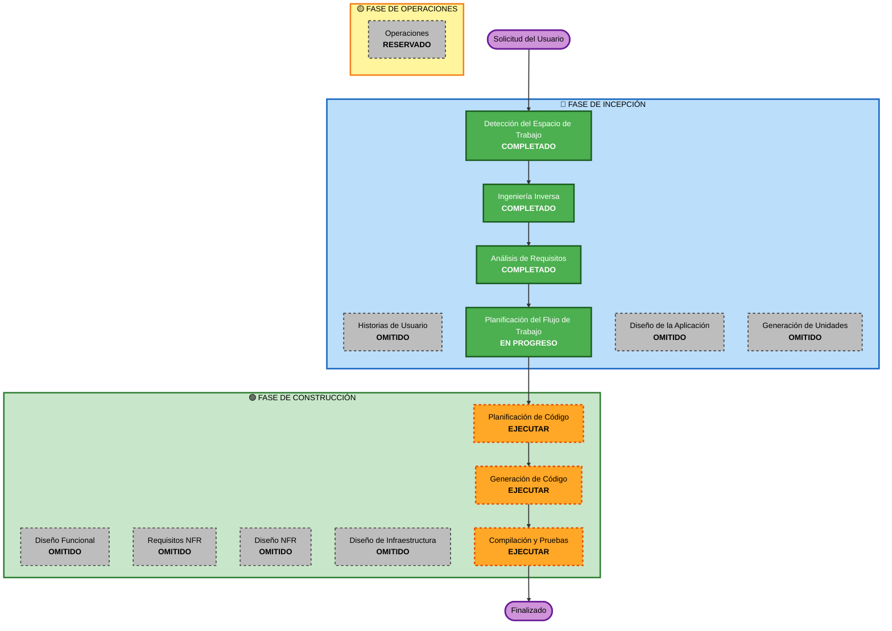

# Plan de Ejecución (Execution Plan)

## Resumen del Análisis Detallado (Detailed Analysis Summary)

### Alcance de Transformación (Brownfield Project)
- **Tipo de Transformación**: Refactorización estética de interfaz, consolidación del sistema de diseño (Design Tokens) e integración de la identidad de marca matriz (gorra de programador con glifo `{/}`).
- **Cambios Principales**:
  - Creación del componente reutilizable `LogoCap.astro` con renderizado SVG vectorial exacto de la gorra y glifo `{/}`.
  - Integración del isotipo en `Navbar.astro`, `Contact.astro` (footer) y como badge de autoría técnica en `Hero.astro`.
  - Reemplazo y modernización de `public/favicon.svg` con la silueta de la gorra adaptada a 32x32 / squircle.
  - Depuración y consolidación de `src/styles/global.css`: eliminación de variables duplicadas y estandarización de la paleta oficial (fondo `#0D1117`, superficie `#161B22`, texto `#F0F6FC`, acento Cyan Arquitecto `#38BDF8`).
  - Refinamiento de contraste, espaciados y tipografía en componentes clave (`Hero.astro`, `Experience.astro`, `Projects.astro`).
- **Componentes Afectados**:
  - `src/components/Navbar.astro`
  - `src/components/Hero.astro`
  - `src/components/Contact.astro`
  - `src/components/Experience.astro`
  - `src/components/Projects.astro`
  - `src/styles/global.css`
  - `public/favicon.svg`
  - `src/components/LogoCap.astro` (nuevo)

### Evaluación de Impacto de Cambios
- **Cambios Visibles al Usuario**: Sí. Identidad visual consistente, logotipo distintivo, paleta cromática sofisticada y mejor legibilidad en dispositivos móviles.
- **Cambios Estructurales de Arquitectura**: No. Se mantiene estrictamente el modelo SSG (Static Site Generation) con Astro v7 sin backend ni infraestructura adicional.
- **Cambios en Modelos de Datos / Base de Datos**: No. No existen bases de datos activas.
- **Cambios en APIs / Contratos Externos**: No. Se preservan todos los enlaces profesionales existentes (LinkedIn, GitHub, correo).
- **Impacto en Requisitos No Funcionales (NFR)**: Altamente positivo. Mejor accesibilidad (WCAG AA), mayor contraste, reducción de CSS redundante y rendimiento web óptimo.

### Relaciones entre Componentes y Grafo de Dependencias

### Evaluación de Riesgo (Risk Assessment)
- **Nivel de Riesgo**: **Bajo (Low)**. Modificaciones puramente estéticas y de marcado en frontend estático sin impacto en lógica de servidor ni dependencias externas.
- **Complejidad de Reversión (Rollback)**: **Sencilla (Easy)**. Todos los cambios están bajo control de versiones Git en un repositorio local.
- **Complejidad de Pruebas**: **Sencilla (Simple)**. Comprobación directa mediante servidor local de desarrollo (`astro dev`), compilación estática (`astro build`) e inspección visual y semántica.

---

## Visualización del Flujo de Trabajo (Workflow Visualization)

### Alternativa Textual del Flujo de Trabajo
- **Fase de Incepción**:
  1. Detección del Espacio de Trabajo: COMPLETADO.
  2. Ingeniería Inversa: COMPLETADO.
  3. Análisis de Requisitos: COMPLETADO.
  4. Historias de Usuario: OMITIDO (no requerido para portafolio personal individual con requerimientos ya cerrados).
  5. Planificación del Flujo de Trabajo: EN PROGRESO.
  6. Diseño de la Aplicación: OMITIDO (cambios dentro de límites de componentes frontend existentes; no hay capa de servicios).
  7. Generación de Unidades de Trabajo: OMITIDO (se trata de una única unidad de trabajo cohesionada de UI/UX).
- **Fase de Construcción (Unidad Única: Identidad de Marca y Refactorización Estética)**:
  1. Diseño Funcional: OMITIDO (no hay lógica de negocio compleja ni esquemas de datos).
  2. Requisitos NFR: OMITIDO (cubiertos en requisitos; reglas de seguridad omitidas a solicitud).
  3. Diseño NFR: OMITIDO (no hay cambios en infraestructura).
  4. Diseño de Infraestructura: OMITIDO (sitio estático en Astro sin cambios de alojamiento).
  5. Planificación de Código (Code Planning): EJECUTAR (creación de plan detallado de implementación por pasos con checkboxes).
  6. Generación de Código (Code Generation): EJECUTAR (implementación de componentes, SVG, estilos y favicons).
  7. Compilación y Pruebas (Build and Test): EJECUTAR (validación con `astro build`, pruebas de renderizado y verificación sin errores).
- **Fase de Operaciones**:
  1. Operaciones: RESERVADO para futuras integraciones de despliegue continuo.

---

## Justificación Detallada de Etapas Omitidas y Ejecutadas

### 🔵 FASE DE INCEPCIÓN
- **Historias de Usuario (SKIP)**: La solicitud es directa y proviene del único usuario y propietario del portafolio. Los requisitos funcionales y criterios de aceptación ya están formalizados en `requirements.md` y `Contexto_mejoras.md`.
- **Diseño de la Aplicación (SKIP)**: No se crearán microservicios, APIs de backend ni capas de servicios complejas; la arquitectura sigue siendo puramente frontend con componentes Astro autosuficientes.
- **Generación de Unidades (SKIP)**: Todo el trabajo constituye una única unidad de trabajo indivisible ("Evolución de Identidad de Marca y Sistema Visual del Portafolio").

### 🟢 FASE DE CONSTRUCCIÓN
- **Diseño Funcional (SKIP)**: No hay algoritmos de negocio complejos ni mutaciones de estado de datos persistentes.
- **Evaluación y Diseño NFR (SKIP)**: No se requieren patrones arquitectónicos nuevos de infraestructura; la extensión de seguridad fue explícitamente omitida por el usuario.
- **Diseño de Infraestructura (SKIP)**: La arquitectura permanece como un sitio estático compatible con cualquier proveedor de hosting estático (GitHub Pages, S3/CloudFront, Cloudflare Pages, etc.).
- **Planificación de Código (EXECUTE)**: Obligatoria por AI-DLC para estructurar paso a paso la generación de código y garantizar trazabilidad mediante checkboxes.
- **Generación de Código (EXECUTE)**: Creación de `LogoCap.astro`, actualización de `Navbar.astro`, `Hero.astro`, `Contact.astro`, `favicon.svg`, `global.css`, `Experience.astro`, `Projects.astro`.
- **Compilación y Pruebas (EXECUTE)**: Verificación exhaustiva de build con `astro build` y comprobación en navegador para garantizar cero regresiones y máxima fidelidad visual.

---

## Criterios de Éxito
1. Integración impecable de la gorra con `{/}` en Navbar, Favicon, Footer y Hero.
2. Normalización de `global.css` eliminando variables duplicadas y aplicando la paleta oficial con acento `#38BDF8`.
3. Compilación limpia y exitosa de `astro build` sin advertencias críticas ni errores.
4. Cero dependencias adicionales añadidas en `package.json`.
5. Experiencia responsive y de contraste visual superior.
