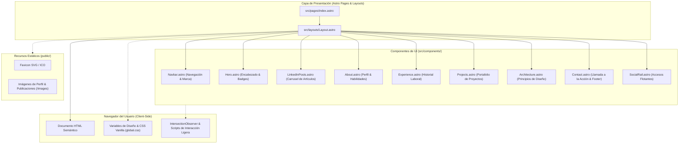
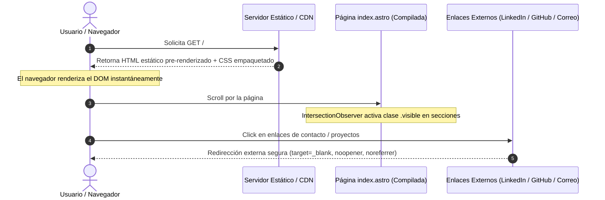

# Arquitectura del Sistema (System Architecture)

## Resumen del Sistema (System Overview)
El proyecto es una aplicación web estática (SSG - Static Site Generation) desarrollada sobre el framework moderno **Astro v7**. Prioriza el rendimiento de carga ultrarrápido al enviar cero JavaScript por defecto al cliente salvo pequeñas islas interactivas (menú móvil, IntersectionObserver para animaciones de scroll y script de carrusel). La arquitectura sigue el principio **Frontend-First** estipulado en `Contexto_mejoras.md`, prescindiendo intencionalmente de bases de datos, APIs de backend propias o microservicios innecesarios.

---

## Diagrama de Arquitectura (Architecture Diagram)

### Alternativa Textual del Diagrama
1. **Navegador del Usuario**: Renderiza el HTML estático resultante con estilos CSS puros (`global.css`) y scripts de cliente puntuales (`IntersectionObserver` para transiciones de scroll y toggles de menú).
2. **Página Principal (`src/pages/index.astro`)**: Ensambla secuencialmente los 9 componentes de interfaz dentro de `Layout.astro`.
3. **Plantilla Base (`src/layouts/Layout.astro`)**: Define la estructura `<head>`, metaetiquetas SEO, importación de fuentes de Google Fonts (Inter) y el observador de visibilidad.
4. **Componentes Astro**: Unidades modulares reutilizables con estilos encapsulados y datos declarativos en frontmatter.
5. **Recursos Estáticos (`public/`)**: Almacena imágenes locales, capturas de publicaciones de LinkedIn y los favicons.

---

## Descripciones de Componentes
- **`Layout.astro`**: Layout maestro que provee las etiquetas HTML estándar, metadatos SEO (`title`, `description`), enlace a `global.css` e inyección de fuentes externas.
- **`Navbar.astro`**: Barra superior de navegación con branding de texto, menú para desktop con efectos hover de subrayado dinámico, y menú hamburguesa responsive para móviles con script inline.
- **`Hero.astro`**: Encabezado visual con rejilla de blueprint en CSS, badge de estado, titular en tipografía grande con acento de color, tags de tecnologías principales, botones de llamada a la acción y tarjeta fotográfica con badge flotante.
- **`LinkedInPosts.astro`**: Galería deslizante horizontal que presenta 4 publicaciones profesionales mediante tarjetas con imágenes y enlaces externos a LinkedIn.
- **`About.astro`**: Declaración concisa del propósito profesional del ingeniero, con píldoras de habilidades interactivas (tags).
- **`Experience.astro`**: Línea de tiempo estructurada con matriz de datos en frontmatter (`experiencias`), describiendo roles en Periferia IT (Líder Técnico BRE-B y Desarrollador Backend).
- **`Projects.astro`**: Catálogo de proyectos destacados (`PIPEHERRE`, `QuickTicket`), con números de índice, categorías y tecnologías.
- **`Architecture.astro`**: Rejilla de 6 principios de diseño de software y sistemas distribuidos.
- **`Contact.astro`**: Sección de contacto con enlaces directos a email (con preformato de Gmail), LinkedIn y GitHub, seguido del footer legal.
- **`SocialRail.astro`**: Barra flotante persistente anclada en el lateral izquierdo (o inferior derecho en móvil) con iconos vectoriales SVG.

---

## Flujo de Datos (Data Flow)

### Alternativa Textual del Flujo de Datos
1. El usuario realiza una petición HTTP GET a la raíz del sitio.
2. El servidor/CDN entrega el documento HTML estático y el CSS precompilado de inmediato.
3. El navegador renderiza la interfaz sin bloqueos de hidratación masiva de JavaScript.
4. Al hacer scroll, los componentes se revelan suavemente mediante el script de `IntersectionObserver`.
5. Las interacciones con enlaces profesionales abren destinos externos de forma segura con `rel="noopener noreferrer"`.

---

## Puntos de Integración (Integration Points)
- **Google Fonts CDN**: Descarga de la fuente tipográfica `Inter` (pesos 400, 500, 600) vía Google Fonts.
- **Enlaces a Redes Profesionales**:
  - LinkedIn: Perfil oficial y publicaciones específicas.
  - GitHub: Perfil `Pipeherre1620`.
  - Gmail Compose: Enlace parametrizado directo a `mail.google.com`.
- **Favicons e Imágenes Locales**: Sin dependencia de CDNs de imágenes de terceros; servidos directamente desde `/public`.

---

## Componentes de Infraestructura (Infrastructure Components)
- **Modelo de Despliegue**: Totalmente estático (compatible con Vercel, Netlify, Cloudflare Pages o AWS S3 + CloudFront).
- **Dependencias de Servidor**: Cero servidores backend dedicados. No requiere base de datos ni middleware en tiempo de ejecución.
