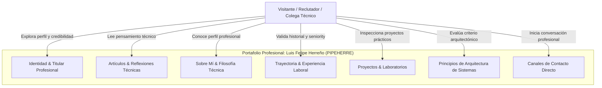

# Visión General de Negocio (Business Overview)

## Diagrama de Contexto de Negocio

### Alternativa Textual del Diagrama
- **Visitante (Reclutador, Líder Técnico, Cliente o Colega)** interactúa con el sistema explorando:
  - Identidad & Titular Profesional (Hero): Primer impacto, título y tecnologías clave.
  - Artículos & Reflexiones (LinkedInPosts): Evidencia de liderazgo de opinión y conocimiento en arquitectura.
  - Sobre Mí (About): Enfoque en sistemas evolutivos y backend/cloud.
  - Experiencia (Experience): Roles, empresas (Periferia IT), ecosistema BRE-B y logros verificables.
  - Proyectos (Projects): Muestras de código y arquitectura (PIPEHERRE, QuickTicket).
  - Principios de Arquitectura (Architecture): 6 pilares de criterio técnico (sistemas distribuidos, resiliencia, etc.).
  - Canales de Contacto (Contact / SocialRail): Email, LinkedIn y GitHub.

---

## Descripción del Negocio
- **Descripción General**: El sistema es la presencia digital y portafolio profesional de Luis Felipe Herreño (Pipe Herre). Actúa como carta de presentación técnica y profesional de alto impacto para reclutadores, líderes de ingeniería y empresas interesadas en perfiles de Líder Técnico y Arquitecto Backend/Cloud.
- **Transacciones de Negocio / Flujos de Valor**:
  1. **Descubrimiento y Posicionamiento de Marca**: Comunicar de forma inmediata el valor profesional diferencial (Backend, Cloud AWS, Sistemas Distribuidos, Liderazgo Técnico).
  2. **Exploración de Evidencia Técnica**: Demostración de publicaciones de criterio técnico en LinkedIn y principios de diseño de sistemas.
  3. **Validación de Experiencia y Trayectoria**: Presentación cronológica estructurada de responsabilidades y logros tangibles en proyectos de alta criticidad (soluciones financieras, BRE-B).
  4. **Inspección de Proyectos**: Presentación de iniciativas personales y laboratorios de arquitectura (QuickTicket POC).
  5. **Conversión y Contacto Directo**: Generación de oportunidades de colaboración mediante enlaces directos a correo electrónico, LinkedIn y GitHub.
- **Glosario de Negocio**:
  - **PIPEHERRE**: Marca personal e identidad profesional matriz de Luis Felipe Herreño.
  - **BRE-B**: Banco de la República de Colombia - Ecosistema de interoperabilidad para pagos inmediatos en tiempo real.
  - **Arquitectura de Marca Monolítica Flexible**: Estrategia de diseño donde la marca matriz (gorra con `{/}`) respalda submarcas de aplicaciones (ej. Herrefinance con gorra `{ $ }`).

---

## Descripciones de Negocio a Nivel de Componente
- **Navbar**: Barra de navegación sticky que proporciona acceso rápido a cada sección del portafolio y visualiza la identidad de marca `PIPEHERRE`.
- **Hero**: Sección principal de bienvenida; proyecta el titular profesional ("Technical Leader • Cloud & Backend Architect"), resumen de valor, badges y llamada a la acción principal.
- **LinkedInPosts**: Carrusel/cinta de publicaciones reales de LinkedIn que validan la voz técnica y pensamiento analítico.
- **About**: Resumen narrativo de visión técnica, enfoque en sistemas mantenibles y etiquetas de competencias centrales.
- **Experience**: Línea de tiempo profesional enfocada en roles, responsabilidades financieras (BRE-B) y tecnologías aplicadas.
- **Projects**: Catálogo curado de proyectos que respaldan la experiencia técnica y arquitectónica.
- **Architecture**: Declaración de 6 principios de diseño de sistemas que diferencian a un desarrollador senior de un arquitecto.
- **Contact**: Sección de cierre para fomentar la interacción profesional vía email y redes.
- **SocialRail**: Barra lateral flotante con accesos directos persistentes a perfiles de GitHub y LinkedIn.
