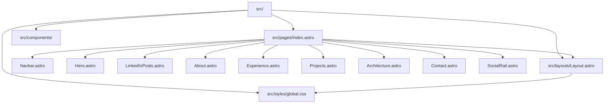

# Estructura de Código (Code Structure)

## Sistema de Compilación (Build System)
- **Tipo**: Astro CLI / Vite (empaquetador moderno)
- **Gestor de Paquetes**: npm
- **Configuración Principal**:
  - `package.json`: Especifica `astro: ^7.2.3`, motor Node `>=22.12.0` y scripts estándares (`dev`, `build`, `preview`, `astro`).
  - `astro.config.mjs`: Archivo de configuración base de Astro usando ESM (`defineConfig({})`).
  - `tsconfig.json`: Hereda de `astro/tsconfigs/strict`, tipado estricto para componentes y scripts TypeScript.

---

## Jerarquía de Módulos y Componentes

### Alternativa Textual de la Jerarquía
- El archivo de entrada principal `src/pages/index.astro` envuelve la aplicación en `src/layouts/Layout.astro`.
- `Layout.astro` consume las variables y estilos globales de `src/styles/global.css`.
- `index.astro` importa e instancia los 9 componentes de la carpeta `src/components/` en orden vertical secuencial:
  1. `Navbar.astro` (Navegación fija)
  2. `Hero.astro` (Portada)
  3. `LinkedInPosts.astro` (Artículos)
  4. `About.astro` (Biografía técnica)
  5. `Experience.astro` (Experiencia)
  6. `Projects.astro` (Proyectos)
  7. `Architecture.astro` (Principios)
  8. `Contact.astro` (Contacto y pie)
  9. `SocialRail.astro` (Riel social fijo)

---

## Inventario de Archivos Existentes (Existing Files Inventory)

| Ruta de Archivo | Propósito / Responsabilidad | Rol en el Proyecto |
| :--- | :--- | :--- |
| `package.json` | Manifiesto del proyecto, dependencias y scripts de ejecución | Configuración |
| `astro.config.mjs` | Configuración de Astro framework | Configuración |
| `tsconfig.json` | Configuración estricta del compilador de TypeScript | Configuración |
| `src/layouts/Layout.astro` | Plantilla HTML principal, metaetiquetas SEO y script de scroll | Estructura base |
| `src/pages/index.astro` | Punto de entrada único del portafolio (Single Page App estática) | Página principal |
| `src/styles/global.css` | Variables de diseño (colores, espaciado, tipografía) y resets CSS | Estilos globales |
| `src/components/Navbar.astro` | Barra de navegación superior, marca tipográfica y menú responsive | Componente UI |
| `src/components/Hero.astro` | Portada con blueprint de fondo, información técnica y foto de perfil | Componente UI |
| `src/components/LinkedInPosts.astro` | Carrusel horizontal con publicaciones técnicas de LinkedIn | Componente UI |
| `src/components/About.astro` | Sección sobre mí, filosofía técnica y píldoras de habilidades | Componente UI |
| `src/components/Experience.astro` | Historial laboral estructurado en objetos de datos y renderizado dinámico | Componente UI |
| `src/components/Projects.astro` | Proyectos destacados con detalle técnico y tecnologías | Componente UI |
| `src/components/Architecture.astro` | Declaración de 6 principios de diseño y arquitectura de software | Componente UI |
| `src/components/Contact.astro` | Formas de contacto, enlaces externos y footer de derechos | Componente UI |
| `src/components/SocialRail.astro` | Barra fija con iconos SVG de LinkedIn y GitHub | Componente UI |
| `public/favicon.svg` | Icono vectorial del sitio para pestañas del navegador | Recurso gráfico |
| `public/favicon.ico` | Icono binario para compatibilidad de navegadores heredados | Recurso gráfico |
| `public/images/*` | Imágenes de fotografía personal y capturas de LinkedIn | Recursos multimedia |

---

## Patrones de Diseño Utilizados (Design Patterns)
1. **Component-Based Architecture**: Modularización estricta mediante componentes `.astro` autosuficientes con estilos scoped.
2. **Data-Driven Presentation**: En componentes como `Experience.astro`, `Projects.astro` y `Architecture.astro`, los datos se declaran como arreglos de objetos en el frontmatter y se mapean limpiamente con `.map()` en la plantilla.
3. **CSS Custom Properties (Design Tokens)**: Definición de variables semánticas en `:root` de `global.css` (`--background`, `--foreground`, `--accent`, `--border`), garantizando consistencia cromática.
4. **Progressive Enhancement / Micro-interacciones**: Uso de `IntersectionObserver` nativo para animaciones de entrada (`fade-in-up`) cuando los elementos entran en el viewport, manteniendo cero carga excesiva de librerías.

---

## Dependencias Críticas (Critical Dependencies)
- **`astro` (^7.2.3)**: Framework principal para generación de sitios estáticos modernos con arquitectura de islas y rendimiento óptimo.
