# Dependencias del Sistema (Dependencies)

## Dependencias Internas entre Módulos

```mermaid
graph TD
    Index["src/pages/index.astro"]
    Layout["src/layouts/Layout.astro"]
    GlobalCSS["src/styles/global.css"]
    
    Navbar["src/components/Navbar.astro"]
    Hero["src/components/Hero.astro"]
    LinkedIn["src/components/LinkedInPosts.astro"]
    About["src/components/About.astro"]
    Exp["src/components/Experience.astro"]
    Proj["src/components/Projects.astro"]
    Arch["src/components/Architecture.astro"]
    Contact["src/components/Contact.astro"]
    Social["src/components/SocialRail.astro"]

    Index --> Layout
    Layout --> GlobalCSS
    Index --> Navbar
    Index --> Hero
    Index --> LinkedIn
    Index --> About
    Index --> Exp
    Index --> Proj
    Index --> Arch
    Index --> Contact
    Index --> Social

    Hero -.->|Usa variables de| GlobalCSS
    Navbar -.->|Usa variables de| GlobalCSS
    About -.->|Usa variables de| GlobalCSS
    Exp -.->|Usa variables de| GlobalCSS
    Proj -.->|Usa variables de| GlobalCSS
    Arch -.->|Usa variables de| GlobalCSS
    Contact -.->|Usa variables de| GlobalCSS
    Social -.->|Usa variables de| GlobalCSS
```

### Alternativa Textual de Dependencias Internas
- `index.astro` depende directamente de `Layout.astro` y de los 9 componentes de interfaz (`Navbar`, `Hero`, `LinkedInPosts`, `About`, `Experience`, `Projects`, `Architecture`, `Contact`, `SocialRail`).
- `Layout.astro` importa e inyecta la hoja de estilos global `global.css`.
- Todos los componentes de interfaz dependen indirectamente de los tokens de diseño definidos en `global.css` (`--background`, `--foreground`, `--accent`, `--border`, etc.).

---

## Dependencias Externas (External Dependencies)

### Dependencias de Producción (`dependencies` en `package.json`)
- **`astro` (`^7.2.3`)**:
  - **Propósito**: Framework principal para generación y orquestación de sitios estáticos modernos.
  - **Licencia**: MIT.
  - **Impacto en el bundle**: Solo emite HTML/CSS estático; no inyecta runtime innecesario.

### Dependencias de Recursos de Terceros
- **Google Fonts API**:
  - `fonts.googleapis.com` y `fonts.gstatic.com` para la tipografía `Inter`.
  - Carga asíncrona optimizada mediante `preconnect`.
